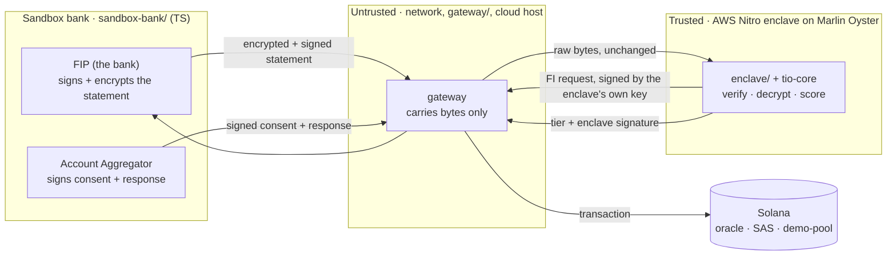
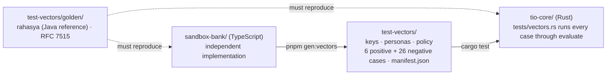

# TEE Income Oracle

TEE Income Oracle turns a bank statement into a loan risk tier without anyone
seeing the statement: not the operator, not the cloud host, not the lender.

1. The borrower shares a bank statement through India's Account Aggregator
   (AA) network.
2. The bank encrypts the statement to a key that exists only inside a secure
   enclave: an AWS Nitro enclave, run on Marlin Oyster.
3. The enclave checks, decrypts and scores the statement. No plain text
   leaves the enclave.
4. The enclave signs only the result, a risk tier. The enclave's Nitro
   attestation document ties the signing key to this repo's code.
5. The tier is written to Solana through the Solana Attestation Service
   (SAS). Any lending program can read the tier and check who signed it.

The hackathon build uses a **sandbox bank**. It is a simulated bank that
speaks the real ReBIT protocol with test keys: simulated bank, real protocol.

## Try it

- **Live demo:** https://tee-income-oracle-web.vercel.app. Get a tier with a
  demo wallet, then borrow and repay against it.
- **Check a tier in the browser:**
  https://tee-income-oracle-web.vercel.app/verify?wallet=8Z6Fa1j6WChXyAgxu6bCyPPUVi9mnuPgWTxM7W8cngAp
  runs the verifier's seven checks from public data. It passed 7 of 7 on
  2026-10-13. You can also click an example borrower on the page.
- **Check a tier from a clone:**
  `pnpm --filter @tio/verifier verify -- <wallet> --cluster devnet`.
  [`docs/VERIFY.md`](docs/VERIFY.md) explains each check.

A wallet attested by a retired enclave build fails the "Entry is active"
check. That failure is expected.

## Where to read next

| You want to | Read |
|---|---|
| Understand how it works and why it is secure | [`docs/ARCHITECTURE.md`](docs/ARCHITECTURE.md) |
| Check a tier yourself | [`docs/VERIFY.md`](docs/VERIFY.md) |
| Look up a wire or data format | [`docs/FORMATS.md`](docs/FORMATS.md), the source of truth for Rust and TypeScript |
| See how the devnet demo is deployed | [`docs/DEPLOY.md`](docs/DEPLOY.md) |
| Write code here | [`docs/CODING-GUIDELINES.md`](docs/CODING-GUIDELINES.md) |
| Branch, commit and release | [`CONTRIBUTING.md`](CONTRIBUTING.md) |
| Work here as an AI agent | [`AGENTS.md`](AGENTS.md): commands, invariants, gotchas |

## Terms

| Term | Meaning |
|---|---|
| AA (Account Aggregator) | A licensed Indian intermediary. It carries a person's financial data between institutions, with that person's consent, and cannot read the data. |
| FIP (Financial Information Provider) | The bank that holds the account. |
| FIU (Financial Information User) | The party that requests the data. Here, the enclave. |
| ReBIT | The technical standard for the AA network: its APIs, messages and data formats. |
| Enclave | An isolated machine whose memory its host cannot read. Here, an AWS Nitro enclave run on Marlin Oyster. |
| Nitro attestation document | A document signed by AWS hardware. It proves which image the enclave runs and which public key the enclave generated. |
| Enclave build | One version of the enclave image, named by its image id. The `oracle` program keeps a registry of approved builds. |
| Tier | The result: A, B, C or REJECT. Only A, B and C are written on chain. |
| SAS attestation | The record on Solana that holds a wallet's tier. It is written through the Solana Attestation Service. |
| surfpool | A local Solana test chain. The tests here run it embedded and offline. |

## How it works

The enclave trusts nothing between itself and the bank. Every byte on that
path is either encrypted to a key created inside the enclave, or signed with a
key pinned into the enclave image. So the network, the gateway and the cloud
host can delay or drop the data. They cannot read it or change it.



### Who signs what

With real banks, the enclave can check only one signature on the data: the
AA's signature on its response. That response names the bank and carries the
encrypted statement. The bank itself does not sign the statement, because the
ReBIT standard has no field for that signature.

So for real data, the guarantee is: "A licensed AA says this bank returned
this statement." The AA is part of what you trust.

The sandbox bank does sign the statement, with its own FIP key. That
signature is an extension in this repo. It lets the enclave check a bank
signature wherever a provider supplies one. Details:
[`docs/ARCHITECTURE.md`](docs/ARCHITECTURE.md) §6.

### What you trust

| You trust | Why |
|---|---|
| AWS Nitro hardware | It keeps the enclave's memory private and signs the Nitro attestation document. |
| The enclave code (`enclave/`, `tio-core/`) | It is published here. The image id ties the running build to this code. |
| The AA | Its signature is the only one on real bank data (see above). |
| Marlin's base image | The enclave runs on it. The verifier pins its measurements. |
| The operator wallet | In the demo, one wallet holds the program upgrade authority and every admin role. After the demo, these move to separate keys, a multisig and a timelock. |

You don't need to trust the network, the gateway, the cloud host or the web
app. They carry bytes, but they can't read or forge them.

### What the tier does not tell you

- It covers one bank account, and the borrower picks which one.
- It is a snapshot of one moment, not ongoing monitoring.
- It counts every credit that didn't bounce as income. That includes
  transfers from the borrower's own accounts and loan payouts.
- It can't stop one person from using several wallets.
- It measures ability to pay, not intent to pay or identity.

**Before a live AA connection:** the enclave creates a new FIU key on every
boot, but a real AA registers an FIU's key once. Going live needs a stable FIU
key or a way to re-register with the AA.
[`docs/ARCHITECTURE.md`](docs/ARCHITECTURE.md) §3, §5 and §6 cover each
limit.

## Status

Pre-alpha, under active development. The formats are frozen
([`docs/FORMATS.md`](docs/FORMATS.md)), and the SAS schema is verified on
devnet.

| Component | What works | Tested against | Runs on |
|---|---|---|---|
| `tio-core` | The whole evaluate pipeline: ties the response and consent to the session, checks the time window, then verifies, decrypts, parses and scores the statement. Builds the attestation payload and the message to sign. | Reference golden vectors, and the separate TypeScript generator in `sandbox-bank` | Inside the enclave |
| `enclave` | HTTP API around `tio-core`: sessions, wallet binding, evaluate, secp256k1-signed results, an attester-signed FIU key. Builds as a reproducible arm64 image. | Every test vector, in process | Marlin Oyster |
| `oracle` program | Enclave registry: register and revoke builds, ids never reused, two-step admin change. Accepts a result only after checking the enclave's signature (secp256k1 precompile), the registry entry and the clock. Then writes the SAS attestation. A refresh replaces only an older one. | Embedded surfpool, with the deployed SAS binary | Devnet |
| `demo-pool` program | Lends test tokens against a SAS attestation. Inside its own instruction, it checks that the oracle's signer wrote the attestation, that it is fresh, and that its enclave build is approved by the pool and not revoked. Lends up to the tier's limit, one open loan per borrower; `repay` closes the loan. | Embedded surfpool | Devnet |
| `sandbox-bank` | ReBIT FIP + AA API: consent, FI request, fetch. Accepts an enclave's FIU key only if its attester is active in the on-chain registry. | Unit tests | Local, Docker, Azure Container Apps (every route except `/health` needs the gateway's bearer token) |
| `gateway` | Runs a whole session for the web: consent, enclave session, wallet-signed intent, FI request and fetch, evaluate. Streams each stage over SSE and relays the signed result to the oracle. Co-signs demo-pool borrow and repay transactions after an 11-rule shape check, so the borrower pays no fees. | A local end-to-end test with the real enclave container, bank and programs | Azure Container Apps |
| `ops` | Admin scripts: oracle config, SAS credential and schema, demo pool, registering the running enclave from its verified Nitro attestation document, devnet end-to-end run, read-only health monitor. | Surfpool | Devnet |
| `verifier` | Checks a wallet's tier from public data alone, in seven checks: the SAS attestation, the registry entry it names, and the archived Nitro attestation document ([`docs/VERIFY.md`](docs/VERIFY.md)). | The real devnet documents, and the real programs on surfpool | Node, browser, CLI |
| `web` | Landing page; borrower flow (demo wallet, consent, live stages, tier read back from chain); loan page that borrows and repays on both pools through the sponsored relay; loan book per pool; verify page. Checks everything the gateway reports against the chain before showing it. | Page tests on a fake devnet | Vercel |

**On devnet now:** both programs, the enclave on Marlin Oyster, the gateway
and sandbox bank on Azure Container Apps, and the web app on Vercel. The
enclave's image id is in [`deployments/devnet.json`](deployments/devnet.json),
and anyone can rebuild the image from this repo.

The headless end-to-end run passes on devnet:

- Tiers A, B and C are attested on chain.
- REJECT leaves nothing on chain.
- Tier A borrows and repays.
- All of the above still pass after an enclave restart with a new key.

[`docs/DEPLOY.md`](docs/DEPLOY.md) explains the deployment.

## Repo layout

Code in `tio-core/` and `enclave/` runs inside the enclave and is trusted.
Everything else is outside the trust boundary.

| Path | What it is |
|---|---|
| [`programs/oracle/`](programs/oracle/README.md) | Anchor program. Enclave registry; checks the enclave's secp256k1 signature through the precompile; writes the SAS attestation. |
| [`programs/demo-pool/`](programs/demo-pool/README.md) | Anchor program. Reads and checks the SAS attestation; lends test tokens. |
| `clients/ts/oracle/`, `clients/ts/demo-pool/` | TypeScript clients for the two programs, generated from their IDLs with Codama. |
| [`tio-core/`](tio-core/README.md) | Rust library with no I/O: crypto, parsing, scoring, payload. **Trusted.** |
| [`enclave/`](enclave/README.md) | Rust HTTP wrapper around `tio-core`. Runs in the Oyster enclave. **Trusted.** |
| [`gateway/`](gateway/README.md) | Node/TS. Runs sessions, relays signed bytes, pays Solana fees, and sponsors the demo pool's borrow and repay after a shape check. |
| [`sandbox-bank/`](sandbox-bank/README.md) | Node/TS mock FIP + AA that speaks ReBIT with test keys. Also generates the test vectors. |
| [`verifier/`](verifier/README.md) | TypeScript library and CLI. Checks a tier end to end from public data. |
| [`ops/`](ops/README.md) | TypeScript admin scripts for a cluster, plus a read-only devnet health monitor that a GitHub workflow runs every 30 minutes. |
| [`web/`](web/README.md) | Vite + React single-page app on `packages/ui`: borrower flow, loan book, verify page. |
| [`packages/ui/`](packages/ui/README.md) | `@tio/ui`: React UI package for `web`. Design tokens (light and dark), shadcn/Radix primitives, ledger patterns. |
| `packages/encoding/` | `@tio/encoding`: strict hex, base64 and base64url encodings shared by the TypeScript code. |
| `deployments/` | Public addresses per cluster, written by `ops`. |
| [`test-vectors/`](test-vectors/README.md) | Generated test fixtures, including golden vectors from Sahamati's reference implementation. |
| `test-fixtures/` | Hand-calculated scoring cases, and the SAS program binary dumped from devnet for offline tests. |
| [`docs/`](docs/README.md) | Architecture, formats, verification, deployment, coding guidelines. |

## Develop

### Prerequisites

You need Rust, Anchor, the Solana (Agave) CLI, Node with pnpm (through
corepack), Docker and Python 3. The versions are pinned in
`rust-toolchain.toml`, `.nvmrc` and `package.json` (`packageManager`).
[`AGENTS.md`](AGENTS.md) → Toolchain lists them all in one place.

### Build systems

The repo has two build systems, plus the enclave image:

- **Rust/Anchor:** a Cargo workspace with `programs/*` and `tio-core`. See the
  root `Cargo.toml`.
- **Node/TypeScript:** a pnpm workspace with `clients/ts/*`, `gateway/`,
  `ops/`, `packages/*`, `programs/*/tests`, `sandbox-bank/`, `verifier/` and
  `web/`. Solana client code uses `@solana/kit` and `sas-lib`. Chain tests
  run on an embedded [surfpool](https://solana.com/docs/tools/surfpool).
- **Enclave:** `enclave/` is not in the Cargo workspace. It builds as a Docker
  image, pinned by digest, and runs with docker-compose on Marlin Oyster.

### Common commands

```sh
cargo build                   # Rust: programs + tio-core
anchor build                  # programs; run before the program and TS tests
cargo test -p tio-core        # Rust tests, against every test vector
anchor test                   # program tests on embedded surfpool
pnpm -r test                  # all TypeScript tests (vitest)
cargo fmt --all -- --check && cargo clippy --all-targets -- -D warnings
```

[`AGENTS.md`](AGENTS.md) → Commands lists every command, including the
enclave image, the admin scripts and the end-to-end runs.

### How the code is tested

`tio-core` is the code the enclave runs. Two independent sources check it:

- outside reference vectors: rahasya (the Java reference) and RFC 7515;
- a separate TypeScript implementation, which writes good cases and
  deliberately broken ones.



Each positive case must pass every check. Each negative case breaks exactly
one layer and must fail with exactly that layer's error code
([`test-vectors/README.md`](test-vectors/README.md)).

## License

Apache-2.0. See [`LICENSE`](LICENSE) and [`NOTICE`](NOTICE).
