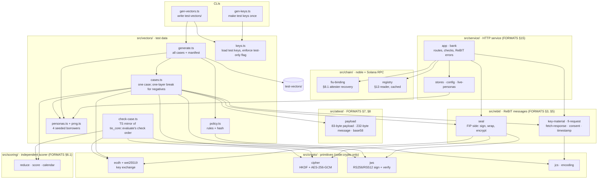

# sandbox-bank

A Node/TypeScript mock **FIP + AA**. It speaks the real ReBIT protocol with
test data: simulated bank, real protocol. **Untrusted:** the enclave checks
its signatures but can't vouch for the data it makes up.

It runs locally, in Docker, and on Azure Container Apps for the devnet demo.
The same crypto code also generates `test-vectors/`.

## What it does

- **Serves four borrower personas** (DEPOSIT schema, 6–12 months):
  salaried and steady, lumpy trader, declining, stressed. The live service
  rebuilds each statement so it ends on the day the enclave asks for.
- **Serves the ReBIT HTTP API** (`docs/FORMATS.md` §15):

  | Route | What it does |
  |---|---|
  | `POST /fiu-keys` | Registers an enclave's FIU key. The attester address recovered from its binding signature (§8.1) must be an active entry in the on-chain oracle registry (§13). |
  | `POST /Consent` | Issues an AA-signed consent for a persona. |
  | `POST /FI/request` | Verifies the enclave's FIU signature, and that its attester is still active. Applies the consent rules (one request per consent). Signs the FI JSON with the FIP key and encrypts it to the enclave's session key (Curve25519 `wei25519`/X25519 → HKDF → AES-256-GCM). Replies with a session id. |
  | `POST /FI/fetch` | Returns the AA-signed fetch response, once per session. |

- **Generates the test vectors.** It writes `test-vectors/` with fixed test
  keys, including the negative cases: one broken layer each
  (`docs/FORMATS.md` §11). These are the cases `tio-core` must accept or
  reject. See [how the code is tested](../README.md#how-the-code-is-tested)
  and the [check order](../test-vectors/README.md#check-order-and-error-codes).

## Access: gateway only

Only the gateway may reach the bank. The gateway does the rate limiting
(FORMATS §15).

- `BANK_TOKEN` is required, and the same value is set on both services.
  Every route except `/health` needs `authorization: Bearer <token>`. The
  token is checked before the body is read.
- Only a local or private-network bank may run without the token, and only
  with `BANK_ALLOW_NO_TOKEN=1`. `start:local` sets it.
- The devnet deployment uses the token, because its Azure environment has no
  private networking (`docs/DEPLOY.md` §4).
- `/fiu-keys` and `/Consent` need no other authentication.

## Keys

- The running service uses **demo keys that are never committed**.
- `pnpm --filter @tio/sandbox-bank gen:demo-keys` makes them once and
  refuses to overwrite.
  - The private JWKs go to `sandbox-bank/.secrets/` (gitignored). Back them
    up outside the repo.
  - The public halves go to `enclave/pinned/` and are compiled into the
    enclave image. New demo keys mean a new image id.
- The test vectors use separate, committed **test-only** keys.

## Replacing it with a real AA

The enclave's protocol code doesn't change. Three things do: the pinned keys,
the base URL, and how the FIU key is onboarded.

This bank accepts a new FIU key on every enclave boot, because the on-chain
registry vouches for it (`POST /fiu-keys`). A real AA onboards an FIU's
public key out of band. So a key that changes on every boot needs either:

- a stable key, e.g. sealed by a KMS to the enclave's measurement; or
- a re-onboarding flow with that AA.

See `docs/ARCHITECTURE.md` §6.

## Build

The Docker build context is the repo root.
`sandbox-bank/Dockerfile.dockerignore` keeps `.secrets/` and the tests out.

```bash
docker build -f sandbox-bank/Dockerfile -t tio-sandbox-bank:dev .
docker run --rm -p 8081:8081 -e SANDBOX_AA_PRIVATE_JWK="$(cat sandbox-bank/.secrets/aa.demo-private.jwk.json)" \
  -e SANDBOX_FIP_PRIVATE_JWK="$(cat sandbox-bank/.secrets/fip.demo-private.jwk.json)" \
  -e SOLANA_RPC_URL=https://api.devnet.solana.com -e BANK_ALLOW_NO_TOKEN=1 tio-sandbox-bank:dev
```

## Run

```bash
pnpm --filter @tio/sandbox-bank start:local   # run the service; demo keys from .secrets/
pnpm gen:vectors                              # rewrite test-vectors/ (deterministic)
```

- `start:local` reads the demo keys from `.secrets/`. Run `gen:demo-keys`
  once first. It defaults `SOLANA_RPC_URL` to a local validator.
- `start` (and the image) read everything from the environment:

  | Env | Meaning |
  |---|---|
  | `SANDBOX_AA_PRIVATE_JWK`, `SANDBOX_FIP_PRIVATE_JWK` | The demo private keys, as JSON text |
  | `SOLANA_RPC_URL` | RPC for the registry reads |
  | `ORACLE_PROGRAM_ID` | Optional |
  | `PORT` | Default 8081 |
  | `PINNED_DIR` | Where the enclave's pinned public keys are |

- The service refuses to start with a test key, or with a key that differs
  from `enclave/pinned/`.

## Test

```bash
pnpm --filter @tio/sandbox-bank test          # vitest
pnpm --filter @tio/sandbox-bank typecheck     # tsc
pnpm --filter @tio/sandbox-bank lint          # oxlint --type-aware
pnpm --filter @tio/sandbox-bank format:check  # oxfmt
```

## Layout

Dependencies point down only:

- `crypto/` holds pure primitives: `node:crypto` only, no runtime
  dependencies.
- `rebit/` builds the ReBIT messages on top of `crypto/`.
- `vectors/` is the test-data logic.
- `chain/` holds the code that needs noble (secp256k1 recovery, keccak) or
  Solana RPC: the §8.1 binding and the registry reader.
- `service/` is the HTTP server (Hono). It reuses `crypto/`, `rebit/` and the
  persona builder from `vectors/`.
- `testing/` holds test-only helpers.



## Gotchas

- It runs on Node 24 with native TypeScript type stripping (no build step).
  So only erasable TypeScript works: no parameter properties, `enum` or
  `namespace`. vitest accepts them, but `node` does not.
