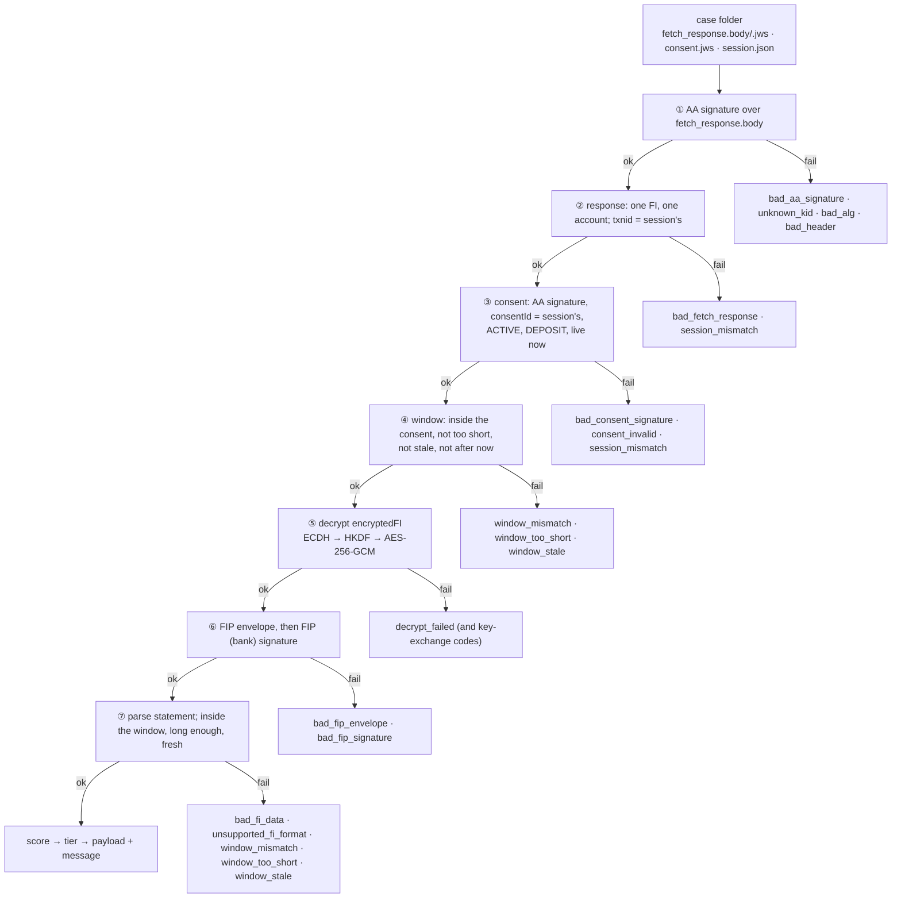

# test-vectors

An answer key for the project's cryptography and scoring. Each vector is a
fixed input plus the exact output it must produce. For example: a bank
statement encrypted to a known key, its signatures, and the tier it should
score to.

The formats are defined in `docs/FORMATS.md` §11.

**All private keys in this folder are TEST ONLY.** They are named
`*.test-private.*` or flagged `private_key_test_only`. No production build
loads them, and no production image pins them.

## What it does

The vectors are used for three things:

- **Proving the code is correct.** `tio-core` (Rust) and the TypeScript
  generator in `sandbox-bank` must reproduce every output byte for byte.
- **Proving the code rejects bad input.** Tampered copies (one byte changed,
  a wrong key, a bad signature algorithm) must fail with a specific error
  code.
- **Proving it works with the real AA network.** `golden/` holds vectors
  produced by Sahamati's reference implementation. Matching them means our
  key exchange and encryption are compatible with real Account Aggregators.

## Rules

- **Generated, never hand-edited.** If code and a vector disagree, find out
  which one is wrong. Regenerate; don't patch the file.
- **Every positive case has negative twins.** Each must FAIL with a specific
  error code. A test that can only pass proves nothing.
- **One broken layer per negative case.** The enclave checks from the outside
  in (`docs/FORMATS.md` §10.1). The generator breaks one layer and re-signs
  everything outside it, so that layer is the one that fails. The full list
  is in `docs/FORMATS.md` §11. It covers:
  - broken signatures and headers: AA, consent, FIP, unpinned key, bad `alg`,
    missing `crit`;
  - a flipped ciphertext;
  - a response or consent from another session (`session_mismatch`);
  - a consent that isn't live;
  - windows that are outside the consent, too short or stale;
  - a statement outside the window or too short;
  - multi-account and multi-FIP responses;
  - a malformed FIP envelope, bad money values and XML FI data.
- **Two cases break two layers on purpose** (`order_*`): a session or window
  error, plus a flipped ciphertext. They must report the session or window
  error. This proves nothing is decrypted before those checks.
- **The generator is TypeScript on purpose.** When two independent
  implementations agree, they catch derivation bugs that one implementation
  testing itself would miss. `golden/` adds a third, external reference.

## Check order and error codes

Each case is one full bank → enclave exchange, sealed in layers.
`tio_core::evaluate` opens the layers from the outside in and stops at the
first failure. Steps ① to ④ run before anything is decrypted. The full table
is in `docs/FORMATS.md` §10.1.



Example: `negative/ciphertext_flipped` flips one byte of the ciphertext. Then
it re-signs the fetch response with the real AA key. Layers ① to ④ pass, so
the failure can only come from ⑤ (`decrypt_failed`). Without the re-sign, ①
would fail first, and the decrypt check would never be tested.

## Build

Regenerate everything from the repo root:

```sh
pnpm gen:vectors
```

- The generator lives in `sandbox-bank/src/vectors/`.
- The output is deterministic. CI fails if a regenerated file differs from
  the committed one.
- The keys are made once, with
  `pnpm --filter @tio/sandbox-bank gen:keys`. It refuses to overwrite.

## Test

`tio-core/tests/vectors.rs` runs every case through `tio_core::evaluate`:

```sh
cargo test -p tio-core
```

## Layout

| Path | What it holds |
|---|---|
| `golden/rahasya/` | Reference vectors from Sahamati's reference ECDH implementation (rahasya V1.2). They prove interop with the real Account Aggregator key exchange. Its README explains how to verify them. |
| `golden/rfc7515/` | RSA keys and the RS256 example from RFC 7515 App. A.2 and RFC 7520 §3.4, extracted by script. They prove our JWS signing and verification match the standard. |
| `keys/` | TEST-ONLY FIP, AA, FIU and rogue RSA keys (+ public JWKs), and the enclave's Curve25519 + secp256k1 test scalars. |
| `personas/` | 4 borrower statements: `salaried_steady` → A, `trader_lumpy` → B, `declining` → C, `stressed` → REJECT. |
| `policy/` | The default scoring policy (JCS bytes) and its hash. |
| `vectors/` | Positive cases: one per persona, plus `rs512_aa` and `x25519_mode`. Each holds the FI request, fetch response, consent, expected hashes, window, tier, scoring features, and the attestation `payload_hex` / `msg_hex` (both null for REJECT). |
| `negative/` | One broken layer per case, with its expected error code. |
| `manifest.json` | Index of all cases, plus the generator version. |
